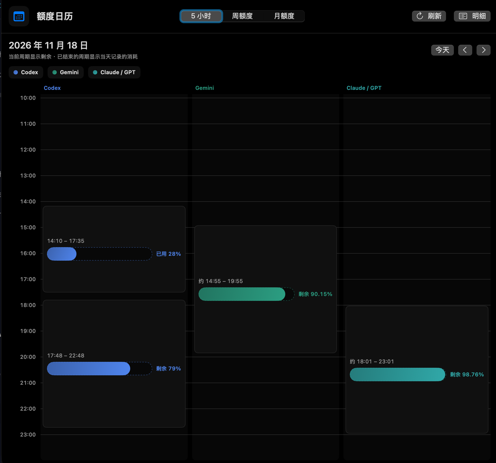
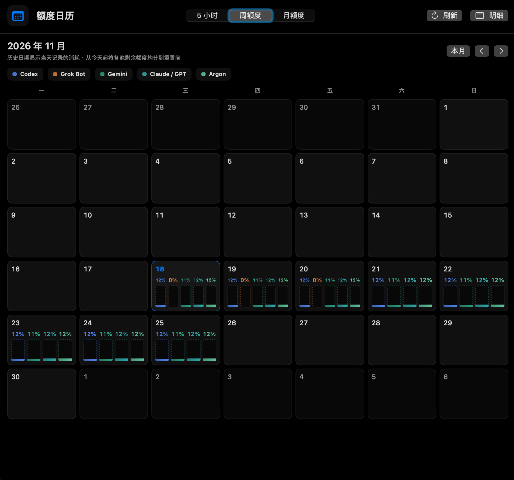
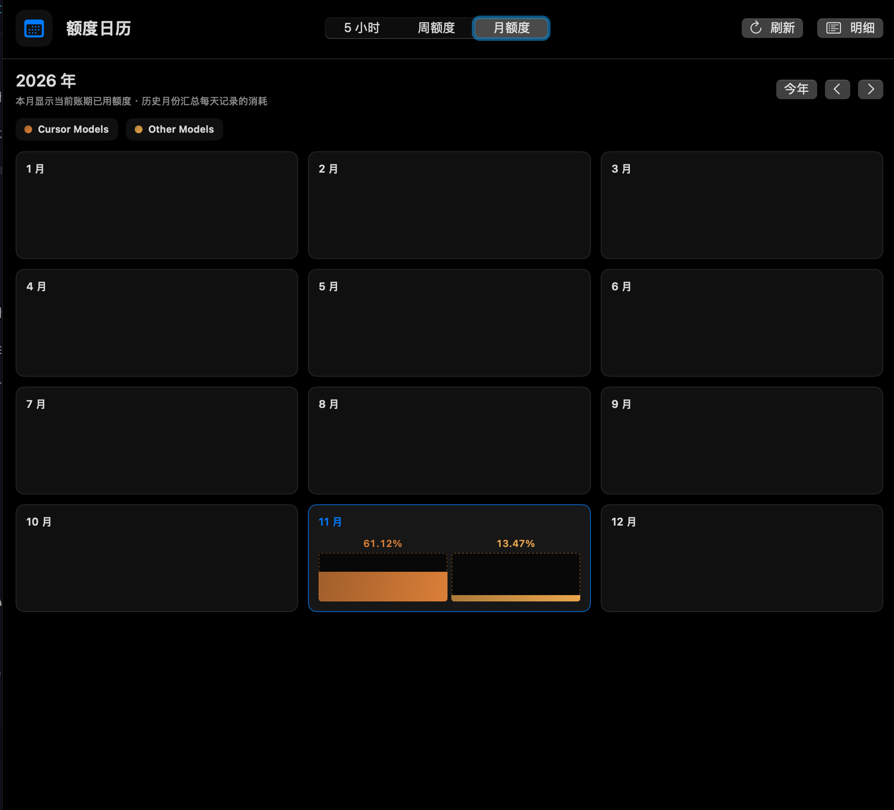

# Token Calendar · 额度日历

Token Calendar 是一款 macOS 应用，把 Codex、Cursor 和 Google Antigravity 的 5 小时、周和月额度放在同一个日历里。应用复用各平台 CLI 的本地登录状态，从首次成功采样开始积累使用记录。

## 安装与启动

需要 **macOS 14 或更新版本**和 **Swift 6 或更新版本**。通过 Xcode 或 `xcode-select --install` 安装 Apple 工具链，用 `swift --version` 确认版本。[安装 Apple Command Line Tools](https://developer.apple.com/documentation/xcode/installing-the-command-line-tools)

按需要跟踪的平台安装 CLI，并使用自己的账号登录。

| 平台 | 登录与核对 | 可读取的额度 |
| --- | --- | --- |
| Codex | 运行 `codex login`，使用 ChatGPT 账号登录。 [Codex CLI](https://learn.chatgpt.com/docs/cli) | 5 小时、周 |
| Cursor | 运行 `agent login` 或 `cursor-agent login`，在浏览器完成登录。 [Cursor CLI](https://cursor.com/docs/cli/overview) | Cursor Models 和 Other Models 的月度池，以及 Grok Bot 的周额度 |
| Antigravity | 运行 `agy` 并登录 Google 账号，然后输入 `/usage` 核对额度。 [Antigravity CLI](https://antigravity.google/docs/cli/install) | 5 小时、周。模型组和适用周期取决于套餐 |

在终端运行下面的命令来克隆、构建和启动应用。

```sh
git clone https://github.com/zl875136491/token-calendar.git
cd token-calendar
sh build-app.sh
open ".build/Token Calendar.app"
```

更新时先退出应用，运行 `git pull --ff-only`，再重新执行构建和打开命令。

## 界面预览

### 5 小时额度

在小时轴上查看各额度池的周期。当前周期显示剩余额度，已结束的周期显示当天记录的消耗。



### 周额度

从今天起，将每个额度池的剩余额度均分到重置前的日历日。过去的日期显示当天记录的消耗。



### 月额度

在 3 列 × 4 行的月份矩阵中查看额度。本月显示当前账期已用额度，历史月份汇总每日记录。



## 记录方式

每个额度池从首次成功读取时建立基线。应用运行时每五分钟采样一次，也可点击右上角「刷新」。点「明细」可查看当前额度、重置时间和已记录的新增用量。

额度变化以百分点计，记在采样当天。历史视图中没有用量记录的日期留空。Antigravity 的周期边界根据倒计时估算。

额度池、周期和每日消耗保存在本机的 `~/Library/Application Support/TokenCalendar/observations.sqlite3`。应用重启后继续已有记录。旧版 `observations.json` 会在首次升级时自动导入。

## 检查采集状态

在仓库目录运行采集检查命令。

```sh
swift run TokenCalendar --check-sources
```

Cursor 使用已登录 CLI 在 macOS 钥匙串中的访问令牌查询额度。首次出现钥匙串访问提示时，可选择允许。Cursor 使用未公开的客户端接口，Antigravity 使用 `agy /usage` 终端面板，采集格式可能随客户端更新而变化。各平台的额度字段和采集入口见[数据来源说明](docs/source_method.md)。

## 许可证

本项目采用 [GNU General Public License v3.0 only（GPL-3.0-only）](LICENSE)。
